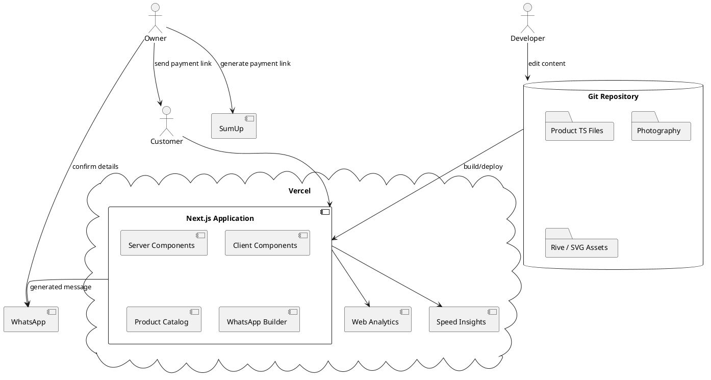
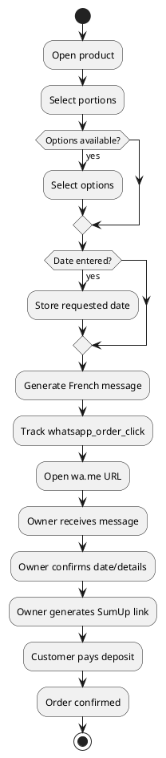

# SPEC-001 — Chat Caféiné Website

## Background

Chat Caféiné — небольшая семейная кофейня и кондитерская в Шартре, Франция.

Сайт должен быть не просто визиткой кафе, а полноценным визуальным каталогом, через который клиент может:

**увидеть ассортимент → понять, что представляет собой десерт → выбрать параметры → отправить сформированную заявку в WhatsApp → согласовать заказ → оплатить предоплату через SumUp → забрать заказ в кафе.**

Основная бизнес-цель сайта — **получение заказов на торты и десерты**.

### Brand Positioning

Chat Caféiné должен восприниматься как:

**семейная современная pâtisserie с домашним подходом и профессиональным качеством.**

Необходимо сохранить баланс:

**Family / Handmade / Appetising / Clear**

Сайт должен быть:

- семейным, но не любительским;
- уютным, но не старомодным;
- красивым, но не luxury-fashion;
- информативным, но не похожим на технический каталог;
- современным, но не стерильным;
- визуально необычным, но простым для заказа.

### Visual Direction

Предоставленные заказчиком AI-концепты являются **основным visual reference**.

Не требуется искать существующий сайт и копировать его стилистику.

Из референсов необходимо сохранить:

- тёплый cream / ivory фон;
- чёрный и тёмно-коричневый текст;
- крупную выразительную serif-типографику;
- большие фотографии реальных десертов;
- фотографии хозяйки во время приготовления;
- сочетание фотографии и лёгкой инфографики;
- ощущение ручной работы;
- семейную историю;
- чёрного кота как постоянного персонажа бренда;
- карточки десертов с визуальным объяснением состава.

Необходимо избавиться от возможного ощущения AI-макета:

- меньше мелких рамок;
- меньше декоративных блоков;
- больше воздуха;
- больше настоящих фотографий;
- меньше текста одновременно на одном экране;
- продукт должен визуально доминировать над инфографикой.

### Business Context

Кафе основано мамой троих детей.

Основная история бренда:

- многие рецепты являются семейными;
- десерты готовились для семьи ещё до появления кафе;
- интерес к приготовлению еды тесно связан с детьми и семьёй;
- отношение к продукту строится по принципу «готовим так, как готовили бы для своей семьи».

Сайт не должен превращать эту историю в длинную биографию.

### Product Philosophy

Необходимо доносить:

- всё готовится вручную;
- используются натуральные продукты;
- используется настоящее сливочное масло;
- не используется маргарин;
- не используются дешёвые заменители;
- не используются промышленные полуфабрикаты;
- качество ингредиентов важнее удешевления продукта.

Торты Chat Caféiné не ориентированы на:

- мастику;
- сложные фигурные конструкции;
- промышленный декор;
- чрезмерное использование красителей.

Стиль оформления:

**naturel / fait maison / élégant / simple / saisonnier.**

### Order Model

Собственный checkout на сайте отсутствует.

Основной flow:

**Product → WhatsApp → confirmation → SumUp payment link → deposit → pickup.**

Доставка отсутствует.

Все заказы забираются в кафе в Шартре.

Формулировка на сайте должна быть спокойной:

**Retrait au café à Chartres uniquement.  
Pas de livraison.**

Это является условием заказа, а не предупреждением об ошибке.

---

## Requirements

### Must Have

#### General

- Сайт должен быть полностью адаптирован под desktop, tablet и mobile.
- Основной язык интерфейса — французский.
- Все основные пользовательские действия должны работать без регистрации.
- CMS не используется.
- Контент вручную изменяется разработчиком через Git repository.
- Собственная база данных для MVP не используется.
- Отдельный backend service для MVP не используется.

#### Homepage

Главная должна содержать:

- Hero;
- Featured Products;
- семейную историю;
- ручное производство / ингредиенты;
- каталог или переход к каталогу;
- процесс заказа;
- информацию о самовывозе;
- адрес кафе;
- часы работы;
- WhatsApp CTA.

#### Hero

Hero должен использовать крупные фотографии.

Допустимые сюжеты:

- готовый торт;
- хозяйка;
- приготовление теста;
- нанесение крема;
- украшение;
- кофе;
- интерьер;
- гости;
- семейная атмосфера.

Рекомендуемый slider:

**3–5 сильных фотографий максимум.**

Приоритет сюжетов:

1. готовый аппетитный продукт;
2. процесс приготовления;
3. хозяйка / атмосфера кафе.

Hero должен содержать один основной CTA:

**Découvrir nos gâteaux**

или:

**Commander un gâteau**

Рядом должна присутствовать информация:

**Sur commande · Retrait à Chartres**

#### Family Story

Раздел должен рассказывать:

- о хозяйке;
- о троих детях;
- о семейных рецептах;
- о приготовлении десертов до открытия кафе;
- о подходе «как для собственной семьи».

Количество текста должно быть небольшим.

#### Catalog

Каталог должен быть построен прежде всего вокруг фотографий.

Каждый продукт:

- photograph;
- name;
- short description;
- price or price from;
- optional badge;
- link to product page.

Категории:

- Gâteaux;
- Cheesecakes;
- Pâtisseries;
- Viennoiseries;
- Confiseries.

Допустимые badges:

- Populaire;
- Saisonnier;
- Sur commande.

#### Product Page

Каждый десерт должен иметь отдельную страницу.

Обязательная информация:

- название;
- крупная фотография;
- короткое описание вкуса;
- цена или `À partir de`;
- количество порций;
- минимальный заказ;
- срок приготовления;
- основные ингредиенты;
- аллергены;
- визуальная схема состава;
- доступные опции;
- возможные добавки;
- допустимые изменения;
- информация о стиле оформления;
- информация о самовывозе;
- WhatsApp CTA.

Особенно важно визуально объяснять продукты с незнакомыми французской аудитории названиями:

- Médovik;
- Napoléon;
- и т.д.

#### Composition

Product Page должна использовать идею предоставленных референсов:

**настоящая фотография продаёт → схема объясняет.**

Пример:

```text
Gâteau au miel
      ↓
Crème légère
      ↓
Gâteau au miel
      ↓
Fruits frais
```

Инфографика не должна визуально доминировать над продуктом.

#### Order Options

При наличии соответствующих вариантов пользователь может выбрать:

- portions;
- size;
- fruits;
- optional additions;
- requested date.

Изменения не должны позволять клиенту случайно изменить базовый рецепт продукта.

#### WhatsApp

CTA:

**Commander sur WhatsApp**

должен создавать предварительно заполненное сообщение.

Пример:

```text
Bonjour 👋

Je souhaite commander :

Médovik
8 personnes
Avec framboises

Date souhaitée :
24 août

Retrait à Chartres.

Merci !
```

Universal `wa.me` links поддерживают предварительно заполненный текст, поэтому отдельная WhatsApp API-интеграция для этого flow не требуется.

#### Mobile Order CTA

На Product Page используется sticky CTA:

```text
┌────────────────────────────────┐
│ À partir de 38 €   [ WhatsApp ]│
└────────────────────────────────┘
```

Он появляется после исчезновения основного CTA из viewport.

#### Black Cat Mascot

Чёрный кот является частью айдентики сайта.

Состояния:

- idle;
- walk;
- sit;
- sleep;
- groom;
- peek;
- play;
- leave.

Кот может:

- пройти по нижней части секции;
- выглянуть из-за изображения;
- сидеть рядом с заголовком;
- спать около footer;
- играть с небольшим объектом;
- встать и уйти.

Кот не должен:

- закрывать текст;
- перекрывать CTA;
- мешать scroll;
- постоянно двигаться;
- появляться поверх важных элементов.

#### Pickup

Информация об отсутствии доставки должна присутствовать:

- на homepage;
- в Product Page;
- около CTA;
- в FAQ;
- в разделе `Commande & retrait`.

---

### Should Have

- фильтрация каталога по категориям;
- Featured Products;
- Seasonal Products;
- Popular Products;
- FAQ;
- карта / directions link;
- часы работы;
- shot list для профессиональной фотосессии;
- analytics;
- SEO metadata;
- OpenGraph;
- sitemap;
- accessibility;
- reduced-motion support.

FAQ:

- Où récupérer ma commande ?
- Faites-vous la livraison ?
- Combien de temps à l'avance faut-il commander ?
- Comment payer ?
- Peut-on modifier la recette ?
- Peut-on personnaliser la décoration ?
- Quels allergènes sont présents ?

---

### Could Have

- анимированная сборка signature cakes;
- 3–5 интерактивных product compositions;
- дополнительные состояния кота;
- seasonal cat animations;
- небольшие easter eggs;
- gallery;
- micro-interactions;
- subtle parallax;
- анимированные ингредиенты.

---

### Won't Have in MVP

- собственная корзина;
- checkout;
- встроенная оплата;
- автоматическое создание SumUp links;
- доставка;
- user accounts;
- authentication;
- loyalty program;
- CMS;
- database;
- отдельный backend service;
- автоматический календарь доступности;
- stock management;
- сложный cake builder;
- real-time inventory;
- автоматическое подтверждение заказа.

---

## Method

### Architecture

Приложение строится как **Next.js full-stack application**, но серверная бизнес-логика в MVP практически отсутствует.

Отдельный backend сейчас не оправдан.

Next.js предоставляет frontend и возможность позднее добавить server functionality в том же приложении. App Router используется для современной full-stack архитектуры Next.js.



### Technology Stack

Recommended stack:

- **Next.js 16.3.x**
- **React**
- **TypeScript**
- **App Router**
- **Tailwind CSS 4**
- **Motion 12.x**
- **Rive React Runtime**
- **next/image**
- **next/font**
- **pnpm**
- **Vercel**
- **Vercel Web Analytics**
- **Vercel Speed Insights**

На август 2026 ветка Next.js 16.3 является доступной актуальной веткой Next.js; перед началом реализации следует зафиксировать последний security/patch release внутри выбранной minor-версии.

Tailwind 4 использует обновлённый PostCSS setup и `@import "tailwindcss"`.

Motion предоставляет React API для UI-, layout- и scroll-анимаций; документация на момент проектирования относится к ветке 12.x.

Rive имеет официальный React runtime и WebGL2 renderer, подходящий для интерактивного mascot со state machine.

### No Separate Backend

Для MVP:

```text
NO CMS
NO DATABASE
NO SEPARATE BACKEND
NO AUTH
NO CART
NO PAYMENT BACKEND
NO WHATSAPP API
```

Но:

```text
Next.js server capabilities remain available.
```

В будущем можно добавить:

```text
/api/orders
/api/availability
/api/payment
/api/contact
```

без миграции на другой frontend framework.

### Application Routes

```text
/
├── /a-propos
├── /menu
├── /gateaux
│   └── /gateaux/[slug]
├── /commande-retrait
└── /contact
```

Navigation:

```text
À propos
Menu
Gâteaux sur commande
Commande & retrait
Contact

[ Commander ]
```

### Repository Structure

```text
src/
├── app/
│   ├── layout.tsx
│   ├── page.tsx
│   ├── gateaux/
│   │   ├── page.tsx
│   │   └── [slug]/
│   │       └── page.tsx
│   ├── a-propos/
│   ├── commande-retrait/
│   └── contact/
│
├── components/
│   ├── layout/
│   ├── home/
│   ├── catalog/
│   ├── product/
│   ├── mascot/
│   ├── animations/
│   └── ui/
│
├── content/
│   ├── products/
│   ├── categories.ts
│   ├── faq.ts
│   └── site.ts
│
├── lib/
│   ├── products.ts
│   ├── whatsapp.ts
│   └── analytics.ts
│
└── types/
    └── product.ts
```

Assets:

```text
public/
├── images/
│   ├── cafe/
│   ├── owner/
│   ├── story/
│   ├── ingredients/
│   └── products/
│
├── animations/
│   └── cat.riv
│
└── icons/
```

### Product Content Model

Один продукт = один TypeScript file.

```text
content/products/

medovik.ts
napoleon.ts
cheesecake.ts
cinnabons.ts
index.ts
```

Schema:

```ts
export interface Product {
  slug: string
  name: string
  subtitle: string

  category: ProductCategory

  shortDescription: string
  description: string

  priceFrom?: number
  portions: number[]

  leadTime: {
    minHours: number
    maxHours?: number
  }

  images: {
    card: string
    hero: string
    cut?: string
    gallery?: string[]
  }

  ingredients: Ingredient[]
  allergens: string[]

  layers?: CakeLayer[]
  options?: ProductOption[]

  badges?: ProductBadge[]

  featured?: boolean
  seasonal?: boolean

  compositionAnimation?: boolean
}
```

Product option:

```ts
interface ProductOption {
  id: string
  label: string

  type:
    | "single"
    | "multiple"

  choices: {
    id: string
    label: string
    priceDelta?: number
  }[]
}
```

Composition layer:

```ts
interface CakeLayer {
  id: string
  label: string
  description?: string
  image?: string
}
```

Example:

```ts
export const medovik = {
  slug: "medovik",

  name: "Médovik",

  subtitle:
    "Gâteau au miel et crème légère",

  category: "gateaux",

  shortDescription:
    "De fines couches au miel accompagnées d'une crème légère.",

  priceFrom: 38,

  portions: [6, 8, 10],

  leadTime: {
    minHours: 48,
  },

  images: {
    card: "/images/products/medovik/card.webp",
    hero: "/images/products/medovik/hero.webp",
    cut: "/images/products/medovik/cut.webp",
  },

  allergens: [
    "gluten",
    "oeufs",
    "lait",
  ],

  featured: true,

  compositionAnimation: true,
} satisfies Product
```

### Homepage Structure

```text
HEADER

HERO
↓
FEATURED CAKES
↓
FAMILY STORY
↓
HANDMADE / INGREDIENTS
↓
CATALOG CTA
↓
HOW TO ORDER
↓
CAFÉ / CHARTRES
↓
FOOTER
```

#### Hero

Desktop:

```text
┌───────────────────────────────────────────────┐
│                                               │
│           LARGE LIFESTYLE PHOTO               │
│                                               │
│   Chat Caféiné                                │
│                                               │
│   Des gâteaux faits maison                    │
│   pour les moments qui comptent.              │
│                                               │
│   [ Découvrir nos gâteaux ]                   │
│                                               │
│   Retrait au café à Chartres                  │
└───────────────────────────────────────────────┘
```

Slider:

- maximum 5 slides;
- visible navigation controls;
- pause when user interacts;
- manual-only fallback for reduced motion.

### Product Catalog

Desktop:

```text
GÂTEAUX SUR COMMANDE

[ Tous ] [ Gâteaux ] [ Cheesecakes ] [ Pâtisseries ]


┌────────────┐ ┌────────────┐ ┌────────────┐
│            │ │            │ │            │
│  MEDOVIK   │ │  NAPOLÉON  │ │ CHEESECAKE │
│   PHOTO    │ │   PHOTO    │ │   PHOTO    │
│            │ │            │ │            │
└────────────┘ └────────────┘ └────────────┘

Médovik         Napoléon       Cheesecake
Gâteau au miel  ...             ...
À partir de 38€ ...
```

Карточка должна передавать минимум информации.

Её задача:

**image → interest → detail.**

### Product Page

Desktop:

```text
┌─────────────────────────────────────────────────┐
│                    MÉDOVIK                      │
│          Gâteau au miel et crème légère         │
├────────────────────┬────────────────────────────┤
│                    │                            │
│   LARGE REAL       │      COMPOSITION           │
│   PRODUCT PHOTO    │                            │
│                    │      layers / labels        │
│                    │                            │
├────────────────────┴────────────────────────────┤
│  6–10 pers.     48 h     from 38 €              │
├─────────────────────────────────────────────────┤
│ Portions                                        │
│ [ 6 ] [ 8 ] [ 10 ]                             │
│                                                 │
│ Options                                         │
│ ○ Sans fruits                                   │
│ ○ Framboises                                    │
│ ○ Fruits rouges                                 │
│                                                 │
│ [ Commander sur WhatsApp ]                     │
├─────────────────────────────────────────────────┤
│ Ingredients / Allergènes / Retrait              │
└─────────────────────────────────────────────────┘
```

Mobile:

```text
PHOTO

NAME
DESCRIPTION

PRICE
PORTIONS
LEAD TIME

[ WHATSAPP ]

COMPOSITION

OPTIONS

INGREDIENTS
ALLERGENS

PICKUP
```

### WhatsApp Algorithm



Builder:

```ts
createWhatsAppOrder({
  product,
  portions,
  options,
  requestedDate,
})
```

Output:

```text
Bonjour 👋

Je souhaite commander :

Médovik
8 personnes

Options :
Framboises

Date souhaitée :
24 août

Retrait au café à Chartres.

Merci !
```

Не отправлять содержимое сообщения или персональные данные пользователя в analytics.

### Cake Composition Animation

Сначала должен быть реализован статический `CakeExplodedView`.

После утверждения UI добавляется animation.

Asset structure:

```text
medovik/
├── layer-01.webp
├── cream-01.webp
├── layer-02.webp
├── cream-02.webp
├── fruit.webp
└── final.webp
```

Animation states:

```text
EXPLODED
↓
LAYERS APPROACH
↓
ASSEMBLED
↓
FINAL REAL CAKE
```

Motion используется только для transform / opacity / layout.

Основной вариант запуска:

**Voir la composition**

или scroll-trigger один раз на desktop.

На mobile предпочтительно явное действие пользователя.

Для `prefers-reduced-motion` отображается статичная схема.

### Cat Architecture

Один основной `.riv` asset.

State machine:

```text
CAT
├── idle
├── walk
├── sit
├── sleep
├── groom
├── peek
├── play
└── leave
```

Использовать заранее определённые безопасные точки:

```ts
const catSpots = [
  {
    section: "hero",
    state: "peek",
  },
  {
    section: "story",
    state: "walk",
  },
  {
    section: "catalog",
    state: "sit",
  },
  {
    section: "footer",
    state: "sleep",
  },
]
```

Не использовать полностью случайное позиционирование.

Один активный Rive mascot одновременно.

Статичные дополнительные коты могут быть SVG.

### Visual Design Tokens

Initial palette:

```css
--color-ink:   #1A1A1A;
--color-cream: #F6F3EE;
--color-warm:  #E8DED0;
--color-sand:  #C9B79C;
--color-brown: #8B6E4F;
```

Эти цвета являются стартовыми и корректируются после получения финальных фотографий.

Typography:

```text
Display / Headings:
Playfair Display

UI / Body:
Montserrat
```

Approximate desktop scale:

```text
H1  64–80px
H2  42–52px
H3  26–32px
Body 16–18px
Small 13–14px
```

### Photography

Перед фотосессией подготовить shot list.

Обязательно:

#### Owner

- portrait;
- behind counter;
- preparing dough;
- adding cream;
- decorating cake;
- interacting naturally with café environment.

#### Products

Для ключевого торта:

- hero shot;
- 45-degree shot;
- top view;
- cut shot;
- macro texture;
- ingredient/detail shots.

#### Café

- interior;
- counter;
- coffee preparation;
- storefront;
- tables;
- guests;
- warm lifestyle scenes.

#### Cat

- sitting;
- sleeping;
- walking;
- looking at camera;
- playing;
- detail portraits.

---

## Implementation

### Phase 1 — Foundation

Create:

```bash
pnpm create next-app@latest chat-cafeine
```

Configure:

- TypeScript;
- App Router;
- Tailwind;
- ESLint;
- pnpm;
- Vercel preview environment.

Environment:

```env
NEXT_PUBLIC_SITE_URL=
NEXT_PUBLIC_WHATSAPP_PHONE=
NEXT_PUBLIC_CAFE_ADDRESS=
```

### Phase 2 — Design System

Implement first:

```text
Container
Section
Heading
Text
Button
Badge
ImageFrame
PickupLabel
WhatsAppButton
```

Then:

```text
Header
Navigation
MobileMenu
Footer
```

Не создавать уникальную UI-систему внутри каждой секции.

### Phase 3 — Static Homepage

Build without advanced animation:

1. Hero;
2. Featured Products;
3. Family Story;
4. Handmade section;
5. Ordering Process;
6. Location;
7. Footer.

На этом этапе кот — static SVG.

### Phase 4 — Product Catalog

Implement:

```text
/gateaux
```

Components:

```text
CategoryTabs
ProductGrid
ProductCard
```

Filtering local-only.

Optional URL:

```text
/gateaux?category=gateaux
```

### Phase 5 — Product Pages

Implement:

```text
/gateaux/[slug]
```

Components:

```text
ProductHero
ProductFacts
PortionSelector
ProductOptionSelector
CakeExplodedView
IngredientList
AllergenList
PickupInformation
WhatsAppOrderCTA
```

Первоначально полностью заполнить минимум:

- Médovik;
- Napoléon;
- один дополнительный популярный продукт.

### Phase 6 — WhatsApp Ordering

Implement:

```text
createWhatsAppMessage()
createWhatsAppUrl()
```

Test:

- desktop browser;
- Android;
- iPhone;
- WhatsApp app;
- WhatsApp Web.

### Phase 7 — Mobile UX

Test at:

```text
375px
390px
430px
768px
1024px
1440px
```

Особое внимание:

- hero crop;
- typography;
- long French labels;
- sticky CTA;
- product options;
- composition;
- cat positions.

### Phase 8 — Photography Integration

Replace all placeholders.

Optimize image sizes.

Folder:

```text
public/images/products/{slug}/
```

Example:

```text
card.webp
hero.webp
cut.webp
detail-01.webp
detail-02.webp
```

### Phase 9 — Cake Animation

Implement only after static composition is approved.

Initial target:

**1 cake.**

After validation:

**3–5 signature products maximum.**

### Phase 10 — Cat Mascot

Progression:

```text
Static SVG
↓
Rive prototype
↓
State machine
↓
Section triggers
↓
Mobile fallback
↓
Performance pass
```

### Phase 11 — SEO / Analytics

Product metadata:

```text
Médovik artisanal à Chartres | Chat Caféiné
```

Implement:

```text
sitemap.ts
robots.ts
OpenGraph images
```

Analytics events:

```text
homepage_product_click
catalog_product_click
product_view
category_selected
portion_selected
product_option_selected
whatsapp_order_click
directions_click
```

Vercel Web Analytics supports custom event tracking, which is suitable for measuring these conversion actions.

Speed Insights can be used to monitor Core Web Vitals from real production usage.

### Phase 12 — Accessibility & Performance

Required:

- keyboard navigation;
- focus states;
- semantic headings;
- alt texts;
- correct button/link semantics;
- reduced motion;
- responsive images;
- lazy-loading below fold;
- deferred Rive loading.

Decorative cat:

```html
aria-hidden="true"
```

when it carries no semantic meaning.

### Development Order

```text
1. Foundation
2. Design system
3. Header / Footer
4. Static Homepage
5. Catalog
6. Product Page
7. Product Content
8. WhatsApp Flow
9. Mobile
10. Photography
11. Cake Composition
12. Cat
13. Motion Polish
14. SEO
15. Analytics
16. Accessibility
17. Performance
18. Production
```

Правило:

**сначала работающий заказ → затем магия.**

---

## Milestones

### M1 — Foundation & Visual System

Deliver:

- repository;
- Next.js application;
- Vercel preview;
- routes;
- typography;
- colors;
- UI primitives;
- navigation;
- responsive foundation.

Acceptance:

визуальная система утверждена и не требует фундаментальной переделки.

**Progress: ~15%**

---

### M2 — Homepage

Deliver:

- Hero;
- slider;
- Featured Products;
- Family Story;
- Handmade section;
- Ordering Process;
- Chartres / Café;
- static cat placements;
- mobile layout.

Acceptance:

за первые несколько экранов клиент понимает:

- что продаётся;
- почему продукт особенный;
- что это семейный бизнес;
- как заказать;
- что доставка отсутствует;
- где забрать заказ.

**Progress: ~35%**

---

### M3 — Catalog & Product Pages

Deliver:

- `/gateaux`;
- categories;
- ProductCard;
- `/gateaux/[slug]`;
- local typed product data;
- composition;
- portions;
- pricing;
- lead time;
- options;
- allergens;
- pickup.

Acceptance:

```text
Homepage
↓
Catalog
↓
Product
↓
Understand product
↓
Choose options
```

работает полностью.

**Progress: ~55%**

---

### M4 — Ordering Flow

Deliver:

- WhatsApp builder;
- prefilled messages;
- portions;
- options;
- date;
- mobile sticky CTA;
- analytics;
- order FAQ.

Acceptance:

реальный клиент может самостоятельно отправить корректную заявку хозяйке.

После M4 продукт является:

**Functional MVP.**

**Progress: ~70%**

---

### M5 — Brand Experience

Deliver:

- professional photography;
- Cake Composition animation;
- animated signature products;
- Rive cat;
- mascot state machine;
- micro-interactions;
- reduced-motion fallbacks.

Priority:

```text
Photography
↓
Cake Composition
↓
Cat
↓
Other Motion
```

Acceptance:

анимации усиливают бренд и не ухудшают заказ или производительность.

**Progress: ~85%**

---

### M6 — Production Readiness

Deliver:

- final French text;
- final pricing;
- actual WhatsApp number;
- real address;
- hours;
- final products;
- metadata;
- sitemap;
- analytics;
- accessibility pass;
- mobile QA;
- performance pass;
- production domain;
- owner approval.

Acceptance:

- no placeholders;
- no broken links;
- all WhatsApp CTAs tested;
- all products correct;
- mobile and desktop approved;
- production build clean.

**Progress: 100%**

### Release Strategy

```text
M1
↓
M2
↓
M3
↓
M4
↓
SOFT LAUNCH
↓
M5
↓
M6
↓
FULL LAUNCH
```

Кот или сложная анимация торта не должны блокировать soft launch.

---

## Gathering Results

После релиза необходимо оценивать не только внешний вид сайта, но и то, выполняет ли он основную бизнес-задачу:

**превращает ли просмотр десерта в запрос на заказ.**

### Primary Conversion

Основная конверсия:

```text
WhatsApp Order Clicks
──────────────────────── × 100
Product Page Views
```

Это главный продуктовый KPI MVP.

### Funnel

Отслеживается:

```text
Homepage Visit
       ↓
Catalog Visit
       ↓
Product View
       ↓
Option Selection
       ↓
WhatsApp Order Click
       ↓
Actual WhatsApp Conversation
       ↓
Confirmed Order
```

Первые пять шагов отслеживаются автоматически на сайте.

Последние два первоначально сопоставляются хозяйкой вручную.

### Analytics Events

Обязательные events:

```text
homepage_product_click
catalog_product_click
product_view
category_selected
portion_selected
product_option_selected
whatsapp_order_click
directions_click
```

Минимальные event properties:

```text
product_slug
product_category
portion_count
source_page
```

Не отправлять:

- имя клиента;
- телефон;
- текст WhatsApp;
- персональную информацию;
- содержание сообщений.

### KPIs

#### 1. Product → WhatsApp Conversion

Показывает, насколько хорошо Product Page превращает интерес в намерение заказать.

```text
whatsapp_order_click
────────────────────────
product_view
```

#### 2. Catalog → Product Conversion

```text
catalog_product_click
────────────────────────
catalog_view
```

Показывает качество карточек и фотографий.

#### 3. Homepage → Catalog Conversion

Показывает, достаточно ли хорошо hero и Featured Products ведут пользователя к ассортименту.

#### 4. Popular Products

Сравнить:

```text
product_view
whatsapp_order_click
```

для каждого продукта.

Это позволит понять:

- какие торты привлекают внимание;
- какие реально хотят заказать;
- какие продукты плохо объяснены.

#### 5. Mobile vs Desktop

Отдельно сравнить:

- Product Page views;
- WhatsApp conversion;
- engagement;
- performance.

Mobile считается приоритетным пользовательским сценарием.

### First 30 Days

Первые 30 дней используются для создания baseline.

Не следует заранее считать произвольную conversion rate «правильной».

Нужно получить реальные значения:

```text
Sessions
Catalog visits
Product views
WhatsApp clicks
Confirmed orders
```

После получения baseline принимаются решения о дальнейшей оптимизации.

### Qualitative Feedback

Хозяйка должна фиксировать повторяющиеся вопросы клиентов.

Например:

> «Сколько порций?»

означает, что информация о portions недостаточно заметна.

> «Где вас забирать?»

означает проблему с pickup communication.

> «Сколько это стоит?»

означает проблему с price presentation.

> «Что такое Médovik?»

означает, что visual composition или description недостаточно понятны.

Это является таким же важным источником UX-информации, как analytics.

### Owner Feedback After Launch

Через 2–4 недели ответить:

- стало ли меньше однотипных вопросов;
- стали ли сообщения в WhatsApp структурированнее;
- понимают ли клиенты минимальный заказ;
- понимают ли сроки приготовления;
- понимают ли отсутствие доставки;
- понимают ли стиль оформления;
- какие продукты спрашивают чаще всего;
- каких данных всё ещё не хватает.

### Performance

Production monitoring должен включать Core Web Vitals.

Target:

```text
LCP ≤ 2.5 s
INP ≤ 200 ms
CLS ≤ 0.1
```

Это рекомендуемые Google пороги для категории `good`.

Оценивать показатели следует по реальным данным пользователей и ориентироваться на 75-й percentile посещений.

Особенно контролировать:

- Hero image;
- slider;
- Rive;
- Cake Composition;
- web fonts;
- Product Gallery.

### Animation Evaluation

Кот и Cake Composition должны оцениваться отдельно от коммерческого funnel.

Проверить:

- мешает ли кот CTA;
- вызывает ли accidental clicks;
- вызывает ли layout shifts;
- ухудшает ли LCP/INP;
- нравится ли персонаж пользователям;
- помогает ли Composition понять неизвестный десерт.

Если декоративная функция заметно ухудшает UX или performance, она упрощается независимо от того, насколько эффектно выглядит.

### Success Criteria

MVP считается успешным, если:

1. клиент самостоятельно понимает ассортимент;
2. неизвестные названия тортов понятны благодаря фотографии и composition;
3. условия самовывоза очевидны;
4. стоимость или начальная стоимость понятна;
5. количество порций понятно;
6. срок приготовления понятен;
7. клиент может сформировать запрос без помощи сотрудника;
8. WhatsApp получает структурированные заявки;
9. сайт хорошо работает на mobile;
10. семейность и ручная работа ощущаются визуально;
11. кот делает бренд узнаваемым, но не мешает UX;
12. фотографии остаются главным продающим элементом;
13. основные Core Web Vitals находятся в хорошем диапазоне;
14. сайт способен принимать реальные заказы уже без последующих технических доработок.

### Post-MVP Decision Point

После накопления реальных заказов необходимо решить, появился ли смысл в backend/database.

Добавлять backend следует только если возникает реальная необходимость:

```text
orders database
availability calendar
daily production limits
automated SumUp links
admin panel
automatic notifications
order statuses
customer accounts
```

Если WhatsApp + ручная работа хозяйки продолжают нормально справляться с объёмом, архитектуру усложнять не требуется.

Основной архитектурный принцип:

> **Не автоматизировать процесс только потому, что его можно автоматизировать. Автоматизировать тогда, когда ручной процесс становится реальным ограничением бизнеса.**

---

## Need Professional Help in Developing Your Architecture?

Please contact me at [sammuti.com](https://sammuti.com) :)